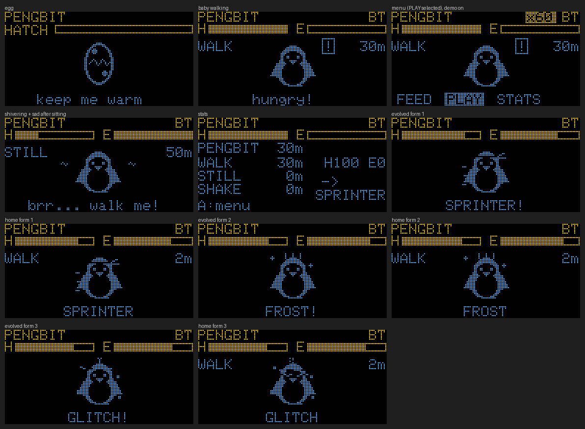

# Pengbit firmware (`pet/`)

The pet itself: our own SSD1306 and MPU-6500 drivers over raw I2C, pet logic in plain C++,
and the §8 line protocol over Bluetooth (Bluefruit BLE UART) and USB serial.



## Flash it

1. Arduino IDE, board package **Seeed nRF52 Boards** (the non-mbed one), board **Seeed XIAO nRF52840** (not Sense).
2. Open `firmware/pet/pet.ino`. No extra libraries needed (Bluefruit ships with the core).
3. Upload. If it fails, double-tap reset and upload again.
4. Serial Monitor at 115200, line ending **Newline**. You should see:
   ```
   # Pengbit fw 0.4
   # OLED 0x3C: ok
   # IMU: MPU-9250 WHO_AM_I=0x71 at 0x68
   # classifier: thresholds
   S,80,80,9,I,1
   ```

If the OLED is mirrored or upside down, swap `0xA1`/`0xA0` or `0xC8`/`0xC0` in `ssd1306.cpp`.
If our OLED driver misbehaves, set `USE_LIB_OLED 1` in `config.h` and install "Adafruit SSD1306".

## Controls

| Input | Does |
|---|---|
| A | Open the menu / move the cursor (FEED, PLAY, STATS) |
| B | Run the selected menu item. With no menu open: flip home / stats screen |
| Hold B 1.5 s | Sound on / off |
| C | Demo mode on / off (60x time) |
| Hold C 1.5 s | **Judge shortcut:** evolve now from the current totals (skips age and happiness gates) |

## Serial commands

Type the same `C,...` lines the page sends: `C,FEED`, `C,PLAY`, `C,DEMO,1`, `C,DEMO,0`, `C,EVO`,
`C,RESET`, `C,HELLO`, `C,NAME,Waddles`. Serial-only extras:

- `RAW` toggles a 50 Hz `x,y,z` stream in g for `edge-impulse-data-forwarder` (protocol lines go quiet on USB while it runs; BLE keeps working).
- `TUNE` toggles `mean:… max:… act:…` once per 2 s window for the Serial Plotter, to tune the thresholds in `config.h`.

## Protocol notes (team brief §8)

All lines are implemented: `H`, `S`, `T`, `E,HATCH`, `E,EVO,n`, `E,HUNGRY`, `E,SAD`, `E,FED`, `E,PLAYED`,
`E,BTN,x`, `E,DEMO,n`, `E,IDLE,min`, `E,MOVE`, `M,act,conf` (only with the ML model), `A,cmd` / `X,cmd`.

- **Time units:** `S` age and `T` totals are in **pet seconds** (`LINK_TIME_SECONDS 1` in `config.h`; set 0 for pet minutes). Values clamp at 99999 so lines stay within 20 bytes.
- `S` form is `9` while it is an egg. Age restarts at 0 when it hatches; evolution age counts from hatching.
- `H,1,0.4` plus `S` and `T` go out on `C,HELLO` and automatically when the page subscribes to notifications.
- `C,EVO` replies `X,EVO` before hatching or after evolving.

## Files

| File | Job |
|---|---|
| `pet.ino` | setup/loop, millis() scheduler, buttons and commands → pet actions |
| `config.h` | pins, timings, thresholds, pet rules, fallback switches |
| `i2c_bus.h`, `arduino_i2c.*` | I2C interface; only this touches `Wire` |
| `ssd1306.*` | OLED init, 1 KB framebuffer, chunked flush |
| `mpu6500.*` | MPU-6500/9250/9255/6050 accel, ±4 g, gyro off |
| `gfx.*`, `font5x7.h`, `sprites.h`, `ui.*` | drawing, screens, placeholder sprites |
| `activity.*` | 2 s windows → STILL / WALK / SHAKE via a `Classifier` (thresholds by default) |
| `activity_ml.*` | Edge Impulse model behind the same interface (`USE_ML_CLASSIFIER 1`) |
| `pet_state.*` | stats, age, totals, hatch, evolution, sitting nudge, events |
| `buttons.*`, `buzzer.*` | debounced short/long presses; non-blocking chirps |
| `link.*` | §8 protocol over BLE UART and USB serial |

## Sprites

`sprites.h` is generated. When Daniel's 32x32 PNGs are in `web/assets/sprites/` (`form0_a.png` … `form3_b.png`, `form9_*` = egg):

```
python3 firmware/tools/sprites_to_h.py --preview /tmp/sprites.png
```

Missing PNGs keep their placeholder.

## Laptop tests

```
cd firmware/host_test && make test      # pet rules, nudge, evolution, thresholds
make preview                            # also renders screens.png
```
